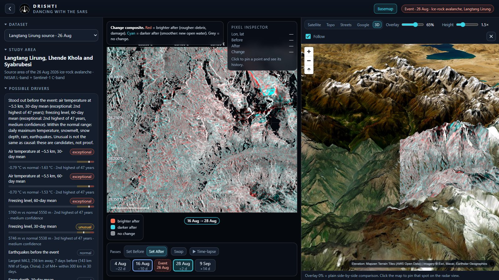
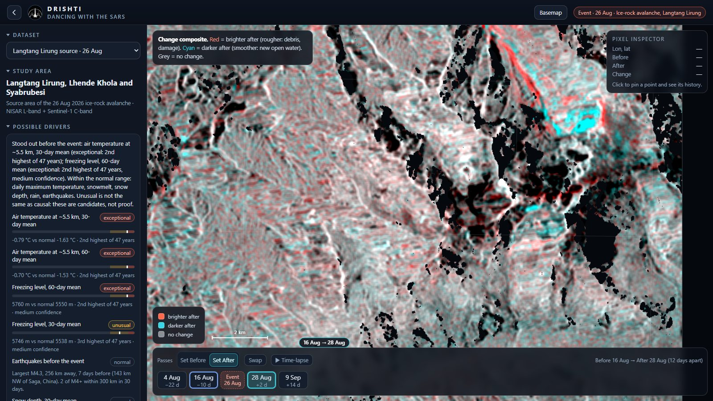
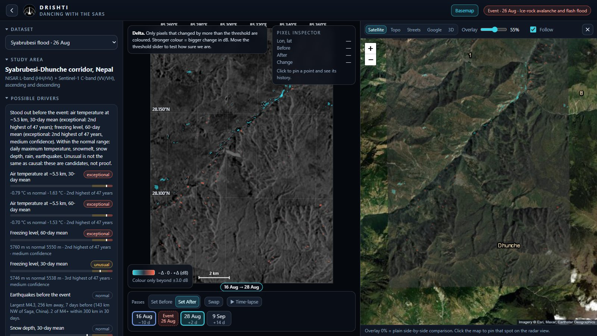
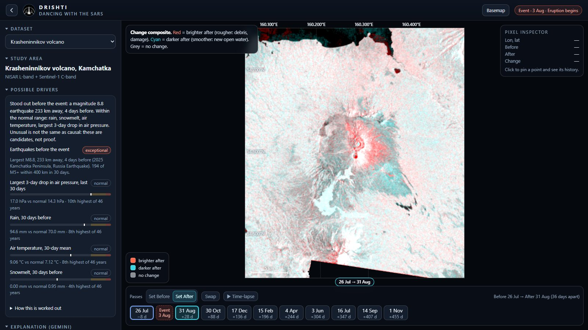
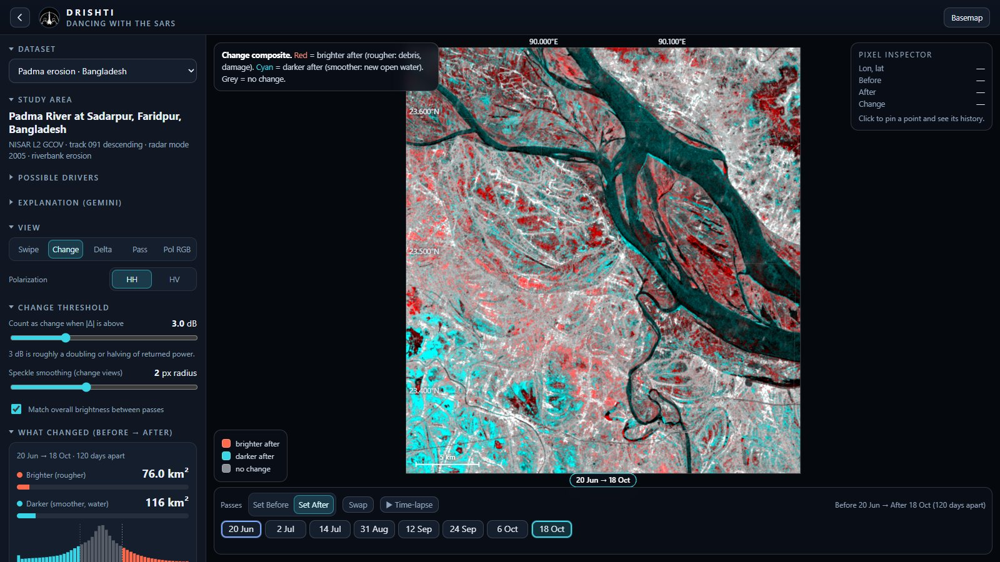
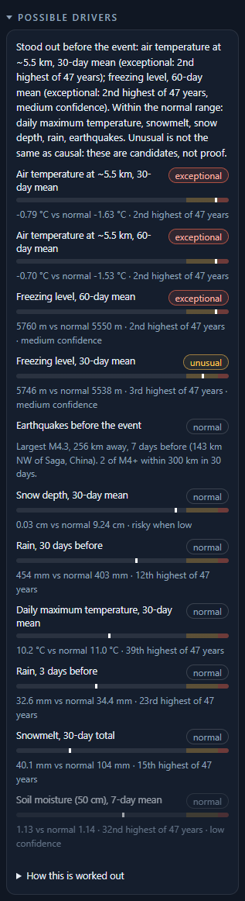
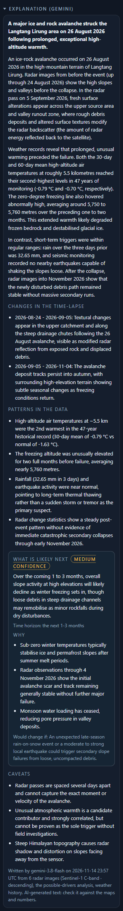
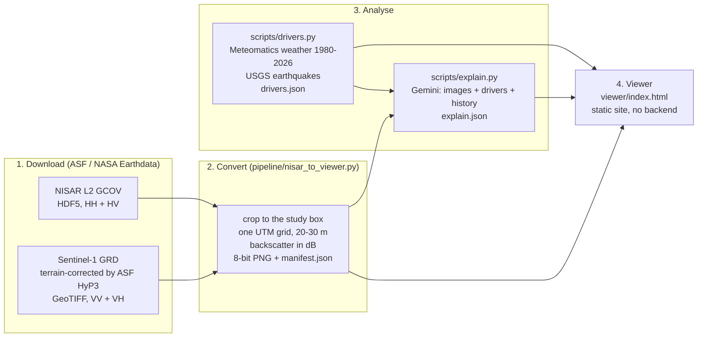

# Drishti: Dancing with the SARs

**See how the ground changes after a disaster, from radar satellites that look through cloud and darkness.**

DRISHTI is a browser app for exploring surface change in NASA-ISRO **NISAR** (L-band) and ESA **Sentinel-1** (C-band) radar images. It compares any two satellite passes over the same place, shows what got rougher or smoother, drapes the result over 3D terrain, tests which weather or earthquake conditions were unusual before each event, and explains the scene in plain language with Google Gemini.

Built by **Rocket Boys** for **NASA Space Apps Challenge 2026** (*Dancing with the SARs*), Hack Athlone.



---

## Contents

- [What it does](#what-it-does)
- [Study sites](#study-sites)
- [Screenshots](#screenshots)
- [Quick start: run the app in two minutes](#quick-start-run-the-app-in-two-minutes)
- [Using the viewer](#using-the-viewer)
- [How it works](#how-it-works)
- [Reproduce everything from raw data](#reproduce-everything-from-raw-data)
- [Add your own site](#add-your-own-site)
- [Project structure](#project-structure)
- [Method notes and limitations](#method-notes-and-limitations)
- [Data sources and credits](#data-sources-and-credits)
- [License](#license)

---

## What it does

| Feature | What you get |
|---|---|
| **Before / after comparison** | Swipe between two passes, or view a change map: **red** = surface got brighter (rougher: debris, damage), **cyan** = darker (smoother: water, wet snow), grey = no change |
| **Two sensors, never mixed** | NISAR L-band (HH/HV) and Sentinel-1 C-band (VV/VH), ascending and descending orbits kept apart, because each sees the ground differently |
| **Change statistics** | Area brighter / darker in km², a change histogram, and a change-over-time chart for every pass |
| **Time-lapse** | Play every pass in date order |
| **Basemaps and 3D** | Satellite (Esri), topographic and street maps, optional Google Maps, and a **3D terrain view** with the radar draped over the mountains |
| **Possible drivers** | For each event: were rain, heat, the freezing level, snow, soil moisture or earthquakes unusual beforehand? Ranked against 1980-2025 using real Meteomatics weather history and the USGS earthquake catalogue |
| **Plain-language explanation** | Google Gemini reads the radar time-lapse, the drivers analysis and the history, then explains what happened and what is likely next, with a confidence level |

---

## Study sites

| Site | Event | Radar data | What the data shows |
|---|---|---|---|
| **Langtang Lirung**, Nepal | Ice-rock avalanche and Bhote Koshi flood, 26 Aug 2026 | NISAR (3 passes), Sentinel-1 ascending (4) and descending (26) | The radar locates the avalanche scar on the north flank and its path toward the Lhende Khola. Heat at ~5.5 km altitude was the 2nd highest in 47 years; rain and earthquakes were normal |
| **Syabrubesi**, Nepal | Flash flood downstream, 26 Aug 2026 | same as above | NISAR shows a clear line of change along the river 2 days after the flood; part of it persists two weeks later |
| **Budhi Gandaki**, Gorkha, Nepal | Landslide-dam breach flood, 11 Oct 2026 | NISAR (3 passes + a 2-pass average), Sentinel-1 descending (26) | Rain in the 30 days before was the 3rd highest in 47 years; the flood itself is hard to see in a narrow gorge |
| **Padma River**, Sadarpur, Bangladesh | Monsoon river change and erosion, Jun-Oct 2026 | NISAR (8 passes, one radar mode) | The floodplain fills and drains through the monsoon; the river fell unusually fast after the peak |
| **Krasheninnikov volcano**, Kamchatka | Eruption, 2-3 Aug 2025 | NISAR (4), Sentinel-1 (10) | Weather was normal; a magnitude 8.8 earthquake struck 233 km away 4 days before |

---

## Screenshots

| | |
|---|---|
|  **Change map**: Sentinel-1, 16 Aug to 28 Aug 2026, zoomed on the Langtang avalanche source |  **Basemap overlay**: NISAR change along the Syabrubesi river drawn over satellite imagery |
|  **Krasheninnikov**: Sentinel-1 across the eruption onset |  **Padma River**: monsoon change, 20 Jun to 18 Oct 2026 |

| Possible drivers | Gemini explanation | Start-up screen |
|---|---|---|
|  |  |  |

---

## Quick start: run the app in two minutes

The repository already contains the processed data for all five sites, so you only need Python (3.8 or newer, no packages) and a browser.

```bash
git clone https://github.com/DeveshShetty/drishti-dancing-with-the-sars.git
cd drishti-dancing-with-the-sars
python viewer/serve.py
```

Open **http://localhost:8000**. Pick a site from the **Dataset** menu.

- The viewer works offline; only the basemaps and 3D view need an internet connection.
- **Optional Google Maps layer:** copy `viewer/config.example.js` to `viewer/config.js` and add a Google Maps JavaScript API key (instructions inside the file). Without a key the Google button is simply hidden.
- Any other static web server works too, for example `python -m http.server 8000 --directory viewer`. `serve.py` only adds no-cache headers so edits show up on reload.

---

## Using the viewer

| Control | What it does |
|---|---|
| **Dataset** | Switch site. The address bar keeps the choice, e.g. `?d=data_langtang` |
| **Sensor** | NISAR, Sentinel-1 ascending or descending. Each is compared only with itself |
| **View** | **Swipe** (drag the handle), **Change** (red/cyan map), **Delta** (only pixels beyond the threshold), **Pass** (one image), **Pol RGB** (both polarizations as colour) |
| **Change threshold** | How many decibels a pixel must change to count. 3 dB = the radar signal doubled or halved |
| **Speckle smoothing** | Averages neighbouring pixels to reduce radar graininess (also blurs narrow features) |
| **Passes** | Choose *Set Before* or *Set After*, then click a date. **Time-lapse** plays every pass |
| **Pixel inspector** | Hover for decibel values; click to pin a point and see its full history |
| **Basemap** | Satellite, Topo, Streets, Google, or **3D**. *Overlay* sets how strongly the radar is drawn on top; *Height* exaggerates the 3D relief |
| **Possible drivers / Explanation (Gemini)** | The root-cause scorecard and the plain-language explanation for the site |

Keyboard: `1`-`5` views, `Left`/`Right` previous / next pass, `Space` time-lapse, `[` hide or show the sidebar, `Esc` skip the start-up screen. Click any sidebar heading to fold it.

---

## How it works



- **The viewer is a single static HTML file.** All comparisons, statistics and colour maps are computed in the browser from the PNGs, so it can be hosted on any static web host.
- **Radar values are stored as 8-bit PNGs:** byte 0 = no data, bytes 1-255 = -30 to +5 dB in steps of about 0.14 dB.
- **Every dataset carries its exact corner coordinates**, so the radar lines up with the basemaps and 3D terrain to within one pixel.
- **API keys are only used by the scripts.** The browser reads saved results (`drivers.json`, `explain.json`) and never calls Meteomatics or Gemini.

---

## Reproduce everything from raw data

You only need this to rebuild the datasets or add new sites. The raw downloads are large: about 130 GB for all five sites.

### 1. Accounts (all free)

| Service | Used for | Sign up |
|---|---|---|
| NASA Earthdata | Downloading NISAR and Sentinel-1, ordering HyP3 terrain correction | https://urs.earthdata.nasa.gov |
| Meteomatics | Weather history for the possible-drivers analysis | https://www.meteomatics.com (Space Apps participants had a free hackathon account) |
| Google AI Studio | Gemini explanations | https://aistudio.google.com/apikey |
| Google Cloud (optional) | Google Maps basemap layer | https://console.cloud.google.com |

### 2. Python environment

```bash
python -m venv .venv
# Windows
.venv\Scripts\activate
# macOS / Linux
source .venv/bin/activate

pip install -r requirements.txt
```

`rasterio`, `h5py` and `pyproj` ship binary wheels for Windows, macOS and Linux, so no system libraries are needed on recent Python versions.

### 3. Keys

```bash
cp .env.example .env        # Windows: copy .env.example .env
```

Fill in `GEMINI_API_KEY`, `METEOMATICS_USER` and `METEOMATICS_PASSWORD`. `.env` is listed in `.gitignore` and is never committed. Environment variables with the same names override it.

The Earthdata login is **not** stored in `.env`. The download libraries read it from a `_netrc` (Windows) or `.netrc` (macOS/Linux) file in your home folder, or ask for it once:

```
machine urs.earthdata.nasa.gov login YOUR_USERNAME password YOUR_PASSWORD
```

### 4. Find scenes

The scene lists used for this project are included: `volcano_scenes.csv`, `volcano_scenes_medium.csv`, `gorkha_scenes.csv`, `gorkha_s1_scenes.csv` and `syabrubesi_extra_scenes.csv`. To search a new area, edit the box in `scripts/volcano_coverage.py` or `scripts/s1_coverage.py` and run it. No login is needed to search.

### 5. Download NISAR

Downloads resume automatically after a dropped connection; run the same command again after any stop.

```bash
# Langtang / Syabrubesi: 16 Aug, 28 Aug, 9 Sep 2026
python scripts/download_nisar.py --csv syabrubesi_extra_scenes.csv --track 48 --direction DESCENDING --out nisar_data
# Budhi Gandaki: 21 Sep, 3 Oct, 15 Oct 2026
python scripts/download_nisar.py --csv gorkha_scenes.csv --track 48 --direction DESCENDING --out nisar_gorkha
# Krasheninnikov
python scripts/download_nisar.py --csv volcano_scenes.csv --track 132 --direction DESCENDING --out nisar_volcano
# Padma, Bangladesh: streams only the study box from each file (about 16 MB per date instead of 7 GB)
python scripts/nisar_bangladesh_erosion.py --every-scene --mode 2005 --before 2026-06 --after 2026-10 --out nisar_bd_out
```

Add `--dry-run` to any `download_nisar.py` command to list the scenes first.

### 6. Sentinel-1, terrain-corrected by ASF HyP3

The script orders radiometric terrain correction (RTC, gamma0, power) from ASF HyP3, waits, downloads and unzips. It skips scenes already downloaded and reuses finished jobs, so rerunning costs no extra credits.

```bash
# Nepal, descending orbit 19 (covers Gorkha, Langtang and Syabrubesi)
python scripts/s1_hyp3_rtc.py --csv gorkha_s1_scenes.csv --track 19 --direction DESCENDING --start 2026-01-01 --end 2026-11-30 --resolution 20 --name gorkha --out s1_gorkha
# Nepal, ascending orbit 85
python scripts/s1_hyp3_rtc.py --csv syabrubesi_extra_scenes.csv --track 85 --direction ASCENDING --start 2026-08-01 --end 2026-09-12 --resolution 20 --name syabrubesi --out s1_syab_asc
# Krasheninnikov, descending orbit 162 (30 m)
python scripts/s1_hyp3_rtc.py --csv volcano_scenes_medium.csv --track 162 --direction DESCENDING --start 2025-07-20 --end 2026-11-01 --name krasheninnikov --out s1_data
```

### 7. Convert to viewer datasets

`pipeline/nisar_to_viewer.py` reads NISAR `.h5` files, Sentinel-1 RTC GeoTIFFs and the Bangladesh GeoTIFFs, crops them to a box, puts every pass on one grid and writes PNGs plus `manifest.json`. The commands used for the published datasets:

```bash
# Langtang Lirung source area
python pipeline/nisar_to_viewer.py --scenes "nisar_data/*_048_D_074_*20260816T*.h5" "nisar_data/*20260828T*.h5" "nisar_data/*20260909T*.h5" "s1_gorkha/*/*_VV.tif" "s1_gorkha/*/*_VH.tif" "s1_syab_asc/*/*_VV.tif" "s1_syab_asc/*/*_VH.tif" --orbit-label "s1_gorkha/**=descending" --orbit-label "s1_syab_asc/**=ascending" --bbox 85.30 28.14 85.56 28.34 --pixel 20 --out viewer/data_langtang --title "Langtang Lirung, Lhende Khola and Syabrubesi" --event 2026-08-26 --event-label "Ice-rock avalanche, Langtang Lirung" --default-pair 2026-08-16 2026-09-09

# Syabrubesi flood
python pipeline/nisar_to_viewer.py --scenes "nisar_data/*_048_D_074_*20260816T*.h5" "nisar_data/*20260828T*.h5" "nisar_data/*20260909T*.h5" "s1_gorkha/*/*_VV.tif" "s1_gorkha/*/*_VH.tif" "s1_syab_asc/*/*_VV.tif" "s1_syab_asc/*/*_VH.tif" --orbit-label "s1_gorkha/**=descending" --orbit-label "s1_syab_asc/**=ascending" --bbox 85.25 28.05 85.37 28.20 --pixel 20 --out viewer/data_nepal --title "Syabrubesi-Dhunche corridor, Nepal" --event 2026-08-26 --event-label "Ice-rock avalanche and flash flood"

# Budhi Gandaki (also adds an average of the two pre-flood NISAR passes)
python pipeline/nisar_to_viewer.py --scenes "nisar_data/*20260828T*.h5" "nisar_gorkha/*20260921T*.h5" "nisar_gorkha/*20261015T*.h5" "s1_gorkha/*/*_VV.tif" "s1_gorkha/*/*_VH.tif" --bbox 84.78 28.02 85.05 28.60 --pixel 20 --out viewer/data_gorkha --title "Budhi Gandaki valley, Gorkha, Nepal" --event 2026-10-11 --event-label "Flood" --average nisar:2026-08-28,2026-09-21

# Padma River, Bangladesh
python pipeline/nisar_to_viewer.py --scenes "nisar_bd_out/*_HH.tif" "nisar_bd_out/*_HV.tif" --bbox 89.90 23.35 90.20 23.65 --pixel 20 --out viewer/data_bangladesh --title "Padma River at Sadarpur, Faridpur, Bangladesh" --default-pair 2026-06-20 2026-10-18

# Krasheninnikov volcano
python pipeline/nisar_to_viewer.py --scenes "nisar_volcano/*.h5" "s1_data/*/*_VV.tif" "s1_data/*/*_VH.tif" --bbox 160.05 54.45 160.50 54.75 --pixel 30 --out viewer/data --title "Krasheninnikov volcano, Kamchatka" --event 2025-08-03 --event-label "Eruption begins"
```

Useful options: `--orbit-label GLOB=TEXT` keeps ascending and descending Sentinel-1 apart; `--average DATE,DATE` adds a lower-noise mean of several passes; `--default-pair` sets the dates the viewer opens on; `--allow-mixed` permits different NISAR tracks (not recommended).

### 8. Possible drivers (Meteomatics + USGS)

```bash
python scripts/mm_check.py              # optional: what your Meteomatics account allows
python scripts/drivers.py all           # or one site: langtang | budhi | padma | volcano
python scripts/drivers.py all --offline # recompute from the saved data only
```

Each site's factors, points and windows are defined in `SITES` at the top of `scripts/drivers.py`. Downloaded series are cached in `meteo/` (not committed; Meteomatics data is licensed per account). The results go to `viewer/<dataset>/drivers.json`.

### 9. Gemini explanations

```bash
python scripts/explain.py all                 # or one dataset, e.g. data_langtang
python scripts/explain.py data_gorkha --dry-run   # build the request without calling the API
```

Each request sends 6 downscaled radar passes, the drivers results and the yearly history, and writes `viewer/<dataset>/explain.json`. One request can take 10-15 minutes on `gemini-3.8-flash`. If Gemini is unavailable, a clearly marked rule-based summary is written instead. Change the model with `GEMINI_MODEL` in `.env`.

### 10. Tests

```bash
python tests/test_synthetic.py   # converter: synthetic scenes with planted changes (22 checks)
python tests/test_explain.py     # Gemini integration with the API mocked (19 tests)
```

---

## Add your own site

1. Find scenes for your box (step 4) and download them (steps 5-6). Keep **one track and direction per sensor**, and one NISAR radar mode where possible.
2. Convert with `pipeline/nisar_to_viewer.py` into `viewer/data_<name>` (step 7).
3. Add the folder to `viewer/datasets.json`: `{"dir": "data_<name>", "label": "My site"}`.
4. Optional: add the site to `SITES` in `scripts/drivers.py`, then run `drivers.py` and `explain.py`.

---

## Project structure

```
drishti-dancing-with-the-sars/
├── viewer/                    the app (static site)
│   ├── index.html             viewer: single HTML file, no build step
│   ├── serve.py               local server with no-cache headers
│   ├── datasets.json          the Dataset menu
│   ├── config.example.js      template for the optional Google Maps key
│   ├── assets/                logo, splash screen, icons
│   └── data*/                 one folder per site: PNG passes, manifest.json, drivers.json, explain.json
├── pipeline/
│   └── nisar_to_viewer.py     NISAR / Sentinel-1 to viewer dataset converter
├── scripts/
│   ├── download_nisar.py      resumable NISAR GCOV downloads
│   ├── s1_hyp3_rtc.py         Sentinel-1 terrain correction via ASF HyP3
│   ├── nisar_bangladesh_erosion.py   streams NISAR subsets, land/water and erosion maps
│   ├── volcano_coverage.py, s1_coverage.py   scene search
│   ├── drivers.py             possible-drivers analysis (Meteomatics, USGS)
│   ├── explain.py             Gemini explanations
│   ├── mm_check.py            Meteomatics account check
│   ├── settings.py            reads keys from environment variables / .env
│   └── _dl.py                 resumable download helper
├── tests/                     converter and Gemini tests
├── docs/images/               README screenshots
├── presentation/              presenter brief
├── *_scenes.csv               scene lists used for the published data
├── requirements.txt
├── .env.example               key template (copy to .env)
└── LICENSE
```

---

## Method notes and limitations

- **NISAR data is provisional.** Public NISAR GCOV products from 2026 are still being validated; treat results as preliminary.
- **Change is not cause.** A brighter or darker surface shows that something changed, not why. The *Possible drivers* card marks conditions that were unusual compared with 1980-2025 (or since 2010); unusual means "candidate", not proof.
- **Radar passes are days apart.** NISAR revisits every 12 days, Sentinel-1 every 12 days per orbit. Short events such as a flood peak are usually missed; the radar shows the ground before and after.
- **Mountains distort radar.** Steep slopes cause layover and shadow; ascending and descending orbits see opposite slopes. Comparisons always use one sensor, one orbit and one direction.
- **Mixed NISAR radar modes create false change.** Passes in different modes (e.g. 2005 and 4005) differ in resolution and noise; prefer pairs in the same mode.
- **Debris-rich floods look bright, not dark.** Muddy, bouldery flood deposits scatter radar energy back, unlike calm water.
- **Weather data quality.** In the Meteomatics history, model soil moisture drops sharply after 2022 and the freezing level steps up around 2014; those factors are marked low or medium confidence and soil moisture is left out of the summaries.
- **Gemini text is AI-generated.** It is instructed to use only the supplied data and to state its confidence, but check it against the maps and numbers.

---

## Data sources and credits

| Source | Use | Terms |
|---|---|---|
| **NISAR** L2 GCOV (NASA / ISRO), via the Alaska Satellite Facility DAAC | Radar images | NASA open data |
| **Copernicus Sentinel-1** (ESA), terrain-corrected with **ASF HyP3** | Radar images | Copernicus free and open data licence; contains modified Copernicus Sentinel data 2025-2026 |
| **Meteomatics** Weather API | Weather history 1980-2026 | Space Apps hackathon access; derived statistics only are published |
| **USGS** earthquake catalogue | Earthquakes before each event | Public domain |
| **Esri** World Imagery and World Topo Map | Basemaps | Esri terms of use, attribution shown in the map |
| **Mapzen Terrain Tiles** on AWS Open Data | 3D elevation | Open data, attribution shown in the map |
| **OpenStreetMap** | Street basemap | ODbL |
| **Google Gemini** | Plain-language explanations | Google AI terms |
| **Leaflet**, **MapLibre GL JS** | Map rendering | BSD-2-Clause, BSD-3-Clause |

Event descriptions draw on public reporting by ICIMOD, Eos (The Landslide Blog), Himalayan Geographic, Down To Earth, The Kathmandu Post and Wikipedia.

Team: **Rocket Boys** · NASA Space Apps Challenge 2026 · Hack Athlone.

---

## License

Code: [MIT](LICENSE) © 2026 Rocket Boys. Satellite and weather data remain under their providers' terms listed above.
